<div align="center">



<a href="https://git.io/typing-svg">
  
</a>

<p>
  <a href="https://rayenchatti.vercel.app"></a>
  <a href="https://linkedin.com/in/chatti-rayen"></a>
  
</p>

</div>


##  About me

```js
const rayen = {
  location:   "Tunisia 🇹🇳",
  studying:   "Software Engineering @ ISIMa (3rd year)",
  focus:      ["Web & Mobile", "AI / RAG", "Cybersecurity"],
  currently:  "Turning hackathon ideas into production apps",
  funFact:    "My portfolio's portrait follows your cursor 👀",
};
```

## 🔥 Featured work

<table>
  <tr>
    <td width="50%" valign="top">
      <h3><a href="https://github.com/rayenchatti/veritaslearn">🧠 VeritasLearn</a></h3>
      AI study assistant: lessons, quizzes and flashcards.<br/><br/>
      🥇 <b>1st Prize</b>, IEEE ISIMa CS SBC OPSYNC Hackathon<br/><br/>
      
      
      
    </td>
    <td width="50%" valign="top">
      <h3><a href="https://github.com/rayenchatti/LifePass">🩺 LifePass</a></h3>
      Medical records shared through a personal QR code.<br/><br/>
      🥇 <b>1st Prize</b>, DevHeist (ISIMa DevOps Club)<br/><br/>
      
      
      
    </td>
  </tr>
  <tr>
    <td width="50%" valign="top">
      <h3><a href="https://github.com/rayenchatti/UCAR-Pulse">🏛️ UCAR Pulse</a></h3>
      AI platform for 30+ University of Carthage institutions.<br/><br/>
      🏆 <b>Top 5 / 30 teams</b>, HACK4UCAR 2025<br/><br/>
      
      
      
    </td>
    <td width="50%" valign="top">
      <h3><a href="https://github.com/rayenchatti/ITGate-internship">🤖 ITGate AI Assistant</a></h3>
      Company-grounded RAG assistant on a local LLM.<br/><br/>
      💼 <b>Summer internship</b>, ITGate Group<br/><br/>
      
      
      
    </td>
  </tr>
</table>

## ⚡ Tech stack

<div align="center">

<br/>
<br/>


</div>

## 📊 GitHub stats

<div align="center">


</div>

## 🐍 Watch the snake eat my contributions

<picture>
  <source media="(prefers-color-scheme: dark)" srcset="https://raw.githubusercontent.com/rayenchatti/rayenchatti/output/github-snake-dark.svg" />
  
</picture>


<div align="center">
  
</div>
