### `> whoami`

- 🎓 Software Engineering student at **ISIMa**, Tunisia
- 🛠️ I build **web & mobile apps** end to end, from idea to deployed product
- 🤖 Into **AI**: RAG pipelines, local LLMs, AI assistants
- 🔐 Growing into **cybersecurity**
- 🏆 **2× hackathon winner**, and I love the 48-hour rush

### `> ls ./featured`

<table>
  <tr>
    <td width="50%" valign="top">
      <h4><a href="https://github.com/rayenchatti/veritaslearn">VeritasLearn</a></h4>
      AI study assistant: lessons, quizzes and flashcards. 
      <b>🥇 1st Prize</b> · OPSYNC Hackathon  
      
      
      
    </td>
    <td width="50%" valign="top">
      <h4><a href="https://github.com/rayenchatti/LifePass">LifePass</a></h4>
      Medical records shared through a personal QR code. 
      <b>🥇 1st Prize</b> · DevHeist  
      
      
      
    </td>
  </tr>
  <tr>
    <td width="50%" valign="top">
      <h4><a href="https://github.com/rayenchatti/UCAR-Pulse">UCAR Pulse</a></h4>
      AI platform for 30+ University of Carthage institutions. 
      <b>🏆 Top 5 / 30</b> · HACK4UCAR 2025  
      
      
      
    </td>
    <td width="50%" valign="top">
      <h4><a href="https://github.com/rayenchatti/ITGate-internship">ITGate AI Assistant</a></h4>
      Company-grounded RAG assistant on a local LLM. 
      <b>💼 Internship</b> · ITGate Group  
      
      
      
    </td>
  </tr>
</table>

### `> cat stack.txt`

 
 

### `> ./stats --live`

<picture>
  <source media="(prefers-color-scheme: dark)" srcset="https://raw.githubusercontent.com/rayenchatti/rayenchatti/output/snake-dark.svg" />
  
</picture>

